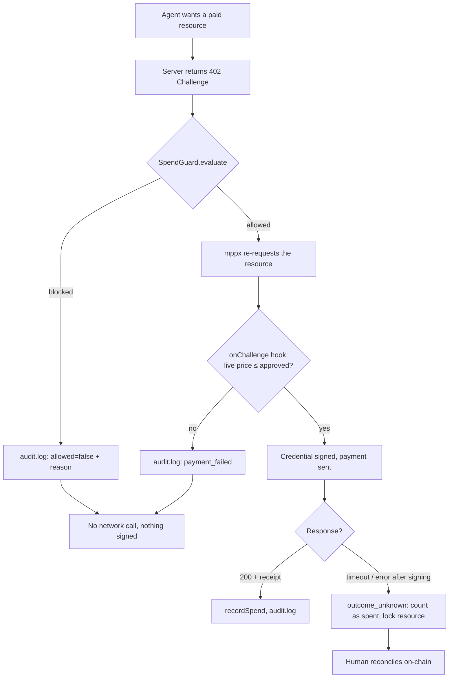

# mpp-spend-guard


> **Status: MVP / testnet only.** Verified end-to-end against a live
> MPP-protected endpoint on Tempo's Moderato testnet. Holds no real funds
> and is not ready for production use.

**A pre-payment guardrail for AI agents that spend money.** Before an agent
signs a payment over the [Machine Payments Protocol (MPP)](https://mpp.dev),
`mpp-spend-guard` checks it against hard limits, blocks anything out of
policy, and writes every decision to an audit log. The check happens
**before money moves, not after.**

**Contents:** [Overview](#1-project-overview) ·
[Safety approach](#2-safety-approach) ·
[Supporting evidence](#3-supporting-evidence) ·
[Limitations](#4-limitations) ·
[Reproduce](#5-reproduce-in-5-minutes) ·
[Usage](#6-usage)

---

## 1. Project overview

### The problem

Agent payment protocols such as MPP (Stripe & Tempo's open standard, launched
March 2026) let an AI agent pay for an API call on its own: the server answers
`402 Payment Required` with a *Challenge* (price, currency, recipient), the
agent's wallet signs a credential, and the request goes through. No human
clicks "confirm".

That's convenient, and it's risky:

- **Payments can't be undone.** A signed on-chain payment settles. There's no
  chargeback.
- **Agents fail in loops.** A retry bug, a prompt injection or a confused plan
  can fire hundreds of paid calls in a minute.
- **Servers set the price.** MPP services price dynamically, so a server can
  quote $0.10 when probed and ask $4 when the agent actually pays.
- **Network failures are ambiguous.** If a request hangs after the credential
  is signed, the agent doesn't know whether it paid. A naive retry can pay twice.

Most wallets and SDKs give agents the *ability* to pay. They don't give the
operator a policy layer between "the agent wants to pay" and "the credential
is signed".

### What this project does

`mpp-spend-guard` is that layer: a small Node.js library that wraps an MPP
client (the official [`mppx`](https://www.npmjs.com/package/mppx) SDK) and
enforces the operator's rules on every payment:

| Check | Blocks |
|---|---|
| Per-request cap | Any single charge above a set maximum |
| Session cap | Cumulative spend beyond the session budget |
| Rate limit | Too many paid requests in a rolling window (runaway loops) |
| Recipient allowlist (optional) | Payments to unknown recipients |
| Price ceiling at signing time | A live challenge that asks for more than was approved |
| Strict amount validation | NaN, Infinity, fractions, strings, negatives, bigint |
| Pending-reconciliation lock | Retrying a payment whose outcome is unknown |

Every decision, allowed or blocked, is appended to `audit.log` as one JSON line.

---

## 2. Safety approach

The project's job is to stop **unauthorized** payments (outside the policy the
human set) and to protect against **irreversible** mistakes (payments that
can't be taken back once signed). Five design principles do that.

### 2.1 Decide before the irreversible step

The only point where a payment can still be stopped is *before the credential
is signed*. Every check runs there. A blocked request never reaches the
network, and the wallet is never asked to sign.



### 2.2 Defense in depth: check twice

The guard approves a challenge seen at one moment, but the real payment comes
from a *fresh* request, and the server's new challenge can quote a different
price. Without a second check, the audit log would say "approved $0.10" while
the wallet paid $4.

[`src/mppClient.js`](src/mppClient.js) closes this gap. It enforces the
approved amount as a **hard ceiling inside mppx's `onChallenge` hook**, which
runs before signing. If the live price is higher than approved, or the
approved amount is missing or invalid, it throws and nothing is signed.

### 2.3 Fail closed

When anything is unclear, the answer is "don't pay":

- Malformed amounts (`NaN` compares `false` against every cap, so a naive
  check would let it through) are denied with `invalid_amount`.
- `recordSpend()` throws on bad input, so the session total can't be corrupted.
- No valid ceiling at signing time means no signature.
- A timeout *after* signing counts the amount as **spent**, not free.

### 2.4 Human in the loop where the machine can't know

If a payment hangs after the credential was signed, software alone can't tell
whether money moved. The guard doesn't guess. It marks the payment
`outcome_unknown`, counts it against the budget, blocks further payments to
that resource (`pending_reconciliation`) and writes the `paymentId` to the log
with a note. A human checks the on-chain balance and resolves it:

```js
guard.reconcile(paymentId, { settled: false }); // didn't settle: release the amount
guard.reconcile(paymentId, { settled: true });  // did settle: keep it counted
```

### 2.5 Every decision is auditable

Each decision is one JSON line in `audit.log` with timestamp, resource,
amount, recipient, allowed/blocked, reason and session total. Blocks are
logged as well as payments, so an operator can see what the agent *tried* to
do, not just what it did. The log can be reconciled against the on-chain
ledger (see the real run below).

### Threat → mitigation

| Threat | Mitigation | Evidence |
|---|---|---|
| Agent overspends on one call | Per-request cap | Unit test + real testnet BLOCK |
| Runaway loop drains budget | Session cap + rate limit | Unit tests |
| Paying an unknown party | Recipient allowlist | Unit test |
| Server raises the price between probe and payment | Ceiling enforced in `onChallenge`, before signing | Unit test (loopback) |
| Malformed or adversarial amount slips past comparisons | Strict integer validation, fail closed | Unit tests (9 malformed inputs) |
| Double payment after an ambiguous timeout | `outcome_unknown` + reconciliation lock | Unit tests (offline) |
| Hanging endpoint stalls the agent | Fetch timeout (default 30 s), nothing recorded if before signing | Unit test (loopback) |

---

## 3. Supporting evidence

### 3.1 Automated tests: 20/20 passing

```bash
npm test     # node --test, loopback only, no keys or internet needed
```

```
# tests 20
# pass 20
# fail 0
```

| File | What it proves |
|---|---|
| [`test/spendGuard.test.js`](test/spendGuard.test.js) (13 tests) | Each cap and limit allows/blocks correctly; every decision (including blocks) reaches the audit log; 9 kinds of malformed amount are denied; bigint never reaches `pay()`; `recordSpend(NaN)` can't corrupt the total; `outcome_unknown` is counted, locks retries and reconciles both ways; other errors record no spend |
| [`test/mppClient.test.js`](test/mppClient.test.js) (7 tests) | Against a local loopback MPP server: refuses to sign when the live price exceeds the approval; accepts at or below it; refuses to sign with a missing/NaN ceiling; a hanging endpoint yields `TIMEOUT_BEFORE_SIGNING` with nothing spent; receipts decode correctly |

### 3.2 Failure states (tested)

| Failure | What happens | Audit `reason` |
|---|---|---|
| NaN / Infinity / 1.5 / `'100'` / `null` / `undefined` / negative amount | Denied before any network call; `recordSpend()` throws so the session total can't be corrupted | `invalid_amount` |
| bigint amount (e.g. `100000n`) | Denied (safe). BigInt-native math is a TODO before mainnet | `invalid_amount` |
| Missing / NaN / non-integer ceiling at signing | `onChallenge` throws `no valid approved amount — refusing to sign`; no credential created | `payment_failed` |
| Endpoint hangs before a challenge is signed | `pay()` aborts after `timeoutMs` with `TIMEOUT_BEFORE_SIGNING`; no spend recorded | `timeout_before_signing` |
| Endpoint hangs / errors *after* signing | Amount counted as spent and held pending; further payments to that resource denied until `guard.reconcile()` | `outcome_unknown`, then `pending_reconciliation` |

`guardedPay()` never throws for payment failures. It returns
`{ paid: false, paymentId, decision, error }` and writes a second audit line
with the outcome.

### 3.3 Real testnet run (Tempo Moderato, Aug 2026)

[`scripts/run-testnet-session.js`](scripts/run-testnet-session.js) ran against
the live MPP-protected endpoint **`https://mpp.dev/api/ping/paid`** (from
mpp.dev's own service catalog) with a freshly generated, faucet-funded testnet
wallet.

- **Wallet:** `0x12b9bE35DB1EbF5F98251a3c591D2e4E45a5843C`
- **Chain:** Tempo Moderato testnet, chainId `42431` (`https://rpc.moderato.tempo.xyz`)
- **Live challenge:** `amount: 100000` (6 decimals = $0.10), `currency: pathUSD`,
  `recipient: 0xf39Fd6e51aad88F6F4ce6aB8827279cffFb92266`

Same real challenge, two guard configurations:

| Scenario | Cap | Result |
|---|---|---|
| ALLOW | `perRequestCapMinor: 200_000` ($0.20) | Guard allowed → mppx paid → `200 OK` + `Payment-Receipt` |
| BLOCK | `perRequestCapMinor: 1_000` ($0.001) | Guard blocked (`exceeds_per_request_cap`) → nothing signed, no network call |

**On-chain confirmation:** the wallet's pathUSD balance went from
`1,000,000,000,000` to `999,999,800,000` raw units (price + Tempo's in-token
network fee). Exactly one payment settled. Decoded receipt:

```json
{"method":"tempo","status":"success","timestamp":"2026-08-06T20:29:53.255Z","reference":"0xd0a0c30d6ac30bf66c527cd9e754b5f2616a018c0310eb7c0ab95899a3063943"}
```

**`audit.log` from the run:** both decisions logged, one paid, one blocked:

```json
{"ts":"2026-08-06T20:29:52.009Z","resource":"https://mpp.dev/api/ping/paid","amountMinor":100000,"recipient":"0xf39Fd6e51aad88F6F4ce6aB8827279cffFb92266","allowed":true,"reason":"ok","sessionSpentMinor":0}
{"ts":"2026-08-06T20:29:53.389Z","resource":"https://mpp.dev/api/ping/paid","amountMinor":100000,"recipient":"0xf39Fd6e51aad88F6F4ce6aB8827279cffFb92266","allowed":false,"reason":"exceeds_per_request_cap","sessionSpentMinor":0}
```

---

## 4. Limitations

This is an MVP. The known weaknesses, roughly from most to least important:

**Scope and enforcement**

- **Opt-in, not enforced by the wallet.** The guard only works if the agent's
  code routes payments through `guardedPay()`. An agent (or injected code)
  holding the private key directly can bypass it. Real enforcement needs the
  key behind the guard, e.g. a signing service, smart-contract spend limits or
  MPP session limits.
- **Testnet only.** No real funds, no audit by a third party.

**Gaps in the checks**

- **Recipient allowlist fails open when the challenge has no recipient.** The
  check only runs if `recipient` is present. It should deny in that case.
- **Recipient and currency are not re-checked at signing time.** The
  `onChallenge` ceiling compares the amount only. A server could change the
  recipient, or switch to a token with different decimals, between the probe
  and the payment.
- **Not safe under concurrency.** `evaluate()` and `recordSpend()` are separate
  steps, so two parallel `guardedPay()` calls can both pass the session cap
  before either is recorded. Needs a reservation/lock step.
- **Rate limit counts only completed payments,** not attempts or blocked calls.
- **No "ask a human above X" tier.** Decisions are allow or block. There's no
  approval queue for payments that are unusual but maybe legitimate.

**Durability and evidence**

- **State is in memory.** Session totals, rate-limit history and pending
  reconciliations reset when the process restarts. The audit log survives,
  but nothing reloads it.
- **Audit log is not tamper-evident.** It's a plain append-only file, with no
  hashing or signing.
- **`outcome_unknown` is verified offline only** (loopback server + fake
  client), not against a real hanging Moderato endpoint.
- **Amounts are JS numbers** (safe up to 2^53 − 1 minor units). BigInt-native
  math is needed before mainnet.

**Planned next steps:** deny on missing recipient; re-check recipient and
currency in `onChallenge`; atomic reserve/commit for concurrent calls;
persistent state; a hash-chained audit log; an optional human-approval tier.

---

## 5. Reproduce in 5 minutes

```bash
git clone https://github.com/KKallias/mpp-spend-guard.git
cd mpp-spend-guard
npm ci
npm test                      # 20/20, loopback only, no keys needed
cp .env.example .env          # fill in a THROWAWAY, faucet-funded testnet key
node --env-file=.env scripts/run-testnet-session.js
cat audit.log                 # one allowed + paid, one blocked
```

Never commit `.env` (it's in `.gitignore`) and never use a key that holds real
funds.

**Funding a testnet wallet:** Tempo's Moderato testnet has a public faucet (as
of Aug 2026 under `tempo.xyz`; check
`tempo.xyz/developers/docs/quickstart/faucet` for the current endpoint):

```bash
curl -X POST https://tempo.xyz/developers/api/faucet \
  -H "Content-Type: application/json" \
  -d '{"address": "<your-wallet-address>"}'
```

---

## 6. Usage

The guard is decoupled from any MPP client: `guardedPay()` accepts any object
with an async `.pay(challenge)` method. [`src/mppClient.js`](src/mppClient.js)
implements it with `mppx` on Tempo Moderato.

```js
const { guardedPay, SpendGuard } = require('./src');
const { createMppClient } = require('./src/mppClient');

const mppClient = createMppClient({ privateKey: process.env.AGENT_WALLET_PRIVATE_KEY });
const guard = new SpendGuard({
  perRequestCapMinor: 200_000,     // $0.20 per call (pathUSD, 6 decimals)
  sessionCapMinor: 1_000_000,      // $1.00 per session
  maxRequestsPerWindow: 30,
  windowMs: 60_000,
  allowedRecipients: ['0x...'],    // optional
});

const { paid, receipt, decision } = await guardedPay(mppClient, challenge, guard);
if (!paid) console.log('Blocked:', decision.reason);
```

### Project layout

| Path | Purpose |
|---|---|
| [`src/spendGuard.js`](src/spendGuard.js) | Decision engine: caps, rate limit, allowlist, validation, reconciliation |
| [`src/index.js`](src/index.js) | `guardedPay()`: evaluate → log → pay → record / handle failure |
| [`src/mppClient.js`](src/mppClient.js) | `mppx` wrapper: signing-time price ceiling, timeout, receipt decoding |
| [`src/auditLog.js`](src/auditLog.js) | Append-only JSONL audit log |
| [`scripts/run-testnet-session.js`](scripts/run-testnet-session.js) | Live ALLOW + BLOCK run on Moderato |
| [`test/`](test) | 20 unit tests, loopback only |

### Related

The same guard idea for the x402 protocol:
[x402-spend-guard](https://github.com/KKallias/x402-spend-guard). MPP's
"session" primitive (pre-authorized spending limit, streamed micropayments)
maps onto these checks more naturally than x402's per-request model.

## License

[MIT](LICENSE)
