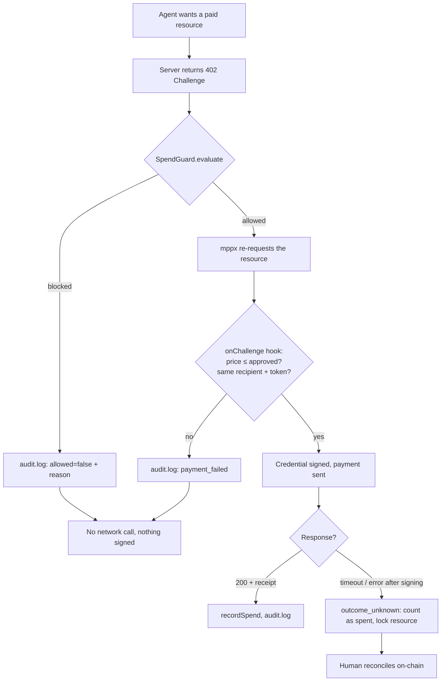

# mpp-spend-guard


> **Status: MVP / testnet only.** Verified end-to-end against a live
> MPP-protected endpoint on Tempo's Moderato testnet. Holds no real funds
> and is not ready for production use.

**A spending guardrail for AI agents.** Before an agent signs a payment over
the [Machine Payments Protocol (MPP)](https://mpp.dev), `mpp-spend-guard`
checks it against limits a human set, blocks anything outside them, and logs
every decision. It acts **before money moves**, because afterwards is too late.

See it work in under a minute, no keys or funds needed:

```bash
git clone https://github.com/KKallias/mpp-spend-guard.git && cd mpp-spend-guard
npm ci && npm run demo
```

**Contents:** [Overview](#1-project-overview) ·
[Safety approach](#2-safety-approach) ·
[Supporting evidence](#3-supporting-evidence) ·
[Limitations](#4-limitations) ·
[Reproduce](#5-reproduce-in-5-minutes) ·
[Usage](#6-usage)

---

## 1. Project overview

### The problem

Agent payment protocols such as MPP (Stripe & Tempo's open standard, launched
March 2026) let an AI agent pay for an API call on its own: the server answers
`402 Payment Required` with a *Challenge* (price, currency, recipient), the
agent's wallet signs a credential, and the request goes through. No human
clicks "confirm".

That is the point of the protocol, and also the danger:

- **Payments can't be undone.** A signed on-chain payment settles. There's no
  chargeback.
- **Agents fail in loops.** A retry bug, a prompt injection or a confused plan
  can fire hundreds of paid calls in a minute.
- **Servers set the price.** MPP services price dynamically, so a server can
  quote $0.10 when probed and ask $4 when the agent actually pays.
- **Network failures are ambiguous.** If a request hangs after the credential
  is signed, the agent doesn't know whether it paid. A naive retry can pay twice.

Wallets and SDKs give an agent the *ability* to pay. Nothing sits between
"the agent wants to pay" and "the credential is signed" to ask whether it
*should*.

### What this project does

`mpp-spend-guard` is that layer: a small Node.js library that wraps an MPP
client (the official [`mppx`](https://www.npmjs.com/package/mppx) SDK) and
enforces the operator's rules on every payment:

| Check | Blocks |
|---|---|
| Per-request cap | Any single charge above a set maximum |
| Session cap | Cumulative spend beyond the session budget |
| Rate limit | Too many paid requests in a rolling window (runaway loops) |
| Recipient allowlist (optional) | Payments to unknown recipients, or to no named recipient at all |
| Price ceiling at signing time | A live challenge that asks for more than was approved |
| Recipient + currency pin at signing time | A live challenge that swaps the payee or the token |
| In-flight reservation | Parallel calls that would each pass the cap alone but overspend together |
| Strict amount validation | NaN, Infinity, fractions, strings, negatives, bigint |
| Pending-reconciliation lock | Retrying a payment whose outcome is unknown |

Every decision, allowed or blocked, is appended to `audit.log` as one JSON line.

---

## 2. Safety approach

Two things can go wrong when an agent pays: the payment is **unauthorized**
(outside what the human allowed), and it is **irreversible** (it can't be
taken back). The design answers both with five rules.

### 2.1 Decide before the irreversible step

The only point where a payment can still be stopped is *before the credential
is signed*. Every check runs there. A blocked request never reaches the
network, and the wallet is never asked to sign.



### 2.2 Defense in depth: check twice

The guard approves a challenge seen at one moment, but the real payment comes
from a *fresh* request, and the server's new challenge can quote a different
price. Without a second check, the audit log would say "approved $0.10" while
the wallet paid $4.

[`src/mppClient.js`](src/mppClient.js) closes this gap inside mppx's
`onChallenge` hook, which runs before signing. Three things must still hold
there, or it throws and nothing is signed:

- the live price is **at or below** the approved amount,
- the **recipient** is the one the guard approved,
- the **currency** is the one the guard approved (the same number in a token
  with different decimals is a different price).

### 2.3 Fail closed

When anything is unclear, the answer is "don't pay":

- Malformed amounts (`NaN` compares `false` against every cap, so a naive
  check would let it through) are denied with `invalid_amount`.
- `recordSpend()` throws on bad input, so the session total can't be corrupted.
- No valid ceiling at signing time means no signature.
- With an allowlist set, a challenge that names no recipient is denied.
- Approved payments are reserved while in flight, so twenty parallel calls
  can't each claim the same remaining budget.
- A timeout *after* signing counts the amount as **spent**, not free.

### 2.4 Human in the loop where the machine can't know

If a payment hangs after the credential was signed, software alone can't tell
whether money moved. The guard doesn't guess. It marks the payment
`outcome_unknown`, counts it against the budget, blocks further payments to
that resource (`pending_reconciliation`) and writes the `paymentId` to the log
with a note. A human checks the on-chain balance and resolves it:

```js
guard.reconcile(paymentId, { settled: false }); // didn't settle: release the amount
guard.reconcile(paymentId, { settled: true });  // did settle: keep it counted
```

### 2.5 Every decision is auditable

Each decision is one JSON line in `audit.log` with timestamp, resource,
amount, recipient, allowed/blocked, reason and session total. Blocks are
logged as well as payments, so an operator can see what the agent *tried* to
do, not just what it did. The log can be reconciled against the on-chain
ledger (see the real run below).

### Threat → mitigation

| Threat | Mitigation | Evidence |
|---|---|---|
| Agent overspends on one call | Per-request cap | Unit test + real testnet BLOCK |
| Runaway loop drains budget | Session cap + rate limit | Unit tests |
| Paying an unknown party | Recipient allowlist, denies missing recipients too | Unit tests |
| Server raises the price between probe and payment | Ceiling enforced in `onChallenge`, before signing | Unit test (loopback) + demo |
| Server swaps the recipient or token at payment time | Recipient and currency pinned in `onChallenge` | Unit tests (loopback) + demo |
| Parallel calls race past the session cap or rate limit | In-flight reservation, taken in the same tick as the check | Unit tests + demo |
| Malformed or adversarial amount slips past comparisons | Strict integer validation, fail closed | Unit tests (9 malformed inputs) |
| Double payment after an ambiguous timeout | `outcome_unknown` + reconciliation lock | Unit tests (offline) |
| Hanging endpoint stalls the agent | Fetch timeout (default 30 s), nothing recorded if before signing | Unit test (loopback) |

---

## 3. Supporting evidence

### 3.1 Offline demo: one command, no keys

`npm run demo` needs no keys, no internet and no funds. Scenarios 4 and 5 run
the real `mppx` client against a local server that changes its quote between
the probe and the payment; the others use a stand-in client that settles
instantly. Actual output:

```
Policy: max $0.20 per call, $0.50 per session, one approved recipient

1. Normal call, $0.10 to the approved recipient
   PAID     within policy

2. Agent tries a $4.00 call
   BLOCKED  exceeds_per_request_cap

3. Agent tries to pay an address that is not on the allowlist
   BLOCKED  recipient_not_allowlisted

4. Server quoted $0.10 when probed, asks $4.00 at payment time
   BLOCKED  MPP payment failed: MPP challenge asks for 4000000 but the guard only approved 100000 — refusing to sign

5. Server keeps the price but swaps the recipient at payment time
   BLOCKED  MPP payment failed: MPP challenge recipient is "0x000000000000000000000000000000000000dEaD" but the guard approved "0xf39Fd6e51aad88F6F4ce6aB8827279cffFb92266" — refusing to sign

6. Runaway loop: 20 calls of $0.10 fired at once
   5 PAID, 15 BLOCKED  session spend $0.50 of $0.50 cap

Audit log: 27 decisions written, 8 allowed.
```

### 3.2 Automated tests: 28/28 passing

```bash
npm test     # node --test, loopback only, no keys or internet needed
```

```
# tests 28
# pass 28
# fail 0
```

| File | What it proves |
|---|---|
| [`test/spendGuard.test.js`](test/spendGuard.test.js) (18 tests) | Each cap and limit allows/blocks correctly; the allowlist denies missing recipients and ignores address casing; parallel calls can't overspend the session cap or the rate limit, and a failed payment frees its reservation; every decision (including blocks) reaches the audit log; 9 kinds of malformed amount are denied; bigint never reaches `pay()`; `recordSpend(NaN)` can't corrupt the total; `outcome_unknown` is counted, locks retries and reconciles both ways; other errors record no spend |
| [`test/mppClient.test.js`](test/mppClient.test.js) (10 tests) | Against a local loopback MPP server: refuses to sign when the live price exceeds the approval, or the recipient or currency differs from it; accepts a matching challenge; refuses to sign with a missing/NaN ceiling; a hanging endpoint yields `TIMEOUT_BEFORE_SIGNING` with nothing spent; receipts decode correctly |

### 3.3 Failure states (tested)

| Failure | What happens | Audit `reason` |
|---|---|---|
| NaN / Infinity / 1.5 / `'100'` / `null` / `undefined` / negative amount | Denied before any network call; `recordSpend()` throws so the session total can't be corrupted | `invalid_amount` |
| bigint amount (e.g. `100000n`) | Denied (safe). BigInt-native math is a TODO before mainnet | `invalid_amount` |
| No recipient on the challenge while an allowlist is set | Denied before any network call | `recipient_not_allowlisted` |
| Live challenge names another recipient or currency | `onChallenge` throws `… but the guard approved … — refusing to sign`; no credential created | `payment_failed` |
| Missing / NaN / non-integer ceiling at signing | `onChallenge` throws `no valid approved amount — refusing to sign`; no credential created | `payment_failed` |
| Endpoint hangs before a challenge is signed | `pay()` aborts after `timeoutMs` with `TIMEOUT_BEFORE_SIGNING`; no spend recorded | `timeout_before_signing` |
| Endpoint hangs / errors *after* signing | Amount counted as spent and held pending; further payments to that resource denied until `guard.reconcile()` | `outcome_unknown`, then `pending_reconciliation` |

`guardedPay()` never throws for payment failures. It returns
`{ paid: false, paymentId, decision, error }` and writes a second audit line
with the outcome.

### 3.4 Real testnet run (Tempo Moderato, Aug 2026)

[`scripts/run-testnet-session.js`](scripts/run-testnet-session.js) ran against
the live MPP-protected endpoint **`https://mpp.dev/api/ping/paid`** (from
mpp.dev's own service catalog) with a freshly generated, faucet-funded testnet
wallet.

- **Wallet:** `0x12b9bE35DB1EbF5F98251a3c591D2e4E45a5843C`
- **Chain:** Tempo Moderato testnet, chainId `42431` (`https://rpc.moderato.tempo.xyz`)
- **Live challenge:** `amount: 100000` (6 decimals = $0.10), `currency: pathUSD`,
  `recipient: 0xf39Fd6e51aad88F6F4ce6aB8827279cffFb92266`

Same real challenge, two guard configurations:

| Scenario | Cap | Result |
|---|---|---|
| ALLOW | `perRequestCapMinor: 200_000` ($0.20) | Guard allowed → mppx paid → `200 OK` + `Payment-Receipt` |
| BLOCK | `perRequestCapMinor: 1_000` ($0.001) | Guard blocked (`exceeds_per_request_cap`) → nothing signed, no network call |

**On-chain confirmation:** the wallet's pathUSD balance went from
`1,000,000,000,000` to `999,999,800,000` raw units (price + Tempo's in-token
network fee). Exactly one payment settled. Decoded receipt:

```json
{"method":"tempo","status":"success","timestamp":"2026-08-06T20:29:53.255Z","reference":"0xd0a0c30d6ac30bf66c527cd9e754b5f2616a018c0310eb7c0ab95899a3063943"}
```

**`audit.log` from the run:** both decisions logged, one paid, one blocked:

```json
{"ts":"2026-08-06T20:29:52.009Z","resource":"https://mpp.dev/api/ping/paid","amountMinor":100000,"recipient":"0xf39Fd6e51aad88F6F4ce6aB8827279cffFb92266","allowed":true,"reason":"ok","sessionSpentMinor":0}
{"ts":"2026-08-06T20:29:53.389Z","resource":"https://mpp.dev/api/ping/paid","amountMinor":100000,"recipient":"0xf39Fd6e51aad88F6F4ce6aB8827279cffFb92266","allowed":false,"reason":"exceeds_per_request_cap","sessionSpentMinor":0}
```

This run predates v0.2. The checks added since (recipient and currency pin,
in-flight reservation, stricter allowlist) are covered by the loopback tests
and the demo above, and have not yet been re-run on testnet.

---

## 4. Limitations

This is an MVP. The known weaknesses, roughly from most to least important:

**Scope and enforcement**

- **The guard is opt-in.** It works only if the agent's code routes payments
  through `guardedPay()`. Code that holds the private key can sign around it.
  This is the main gap, and the fix is architectural: the key has to live
  behind the guard. The path I'd take is a small signing service that owns the
  key and runs these checks, so the agent holds no key at all, backed by MPP
  session limits or on-chain allowances as a second cap the agent can't touch.
- **Testnet only.** No real funds and no third-party audit.

**Gaps in the checks**

- **The recipient and currency pin needs something to pin.** It applies when
  the approved challenge carries those fields (the probe in the testnet script
  does). A caller that passes only an amount gets only the price ceiling.
- **Rate limit counts payments, not attempts.** In-flight and completed
  payments count; blocked attempts don't, so the guard won't notice an agent
  that hammers it with requests it keeps denying.
- **No "ask a human" tier.** A payment is allowed or blocked. There is no
  approval queue for one that is unusual but possibly legitimate.

**Durability and evidence**

- **State is in memory.** Session totals, rate-limit history and pending
  reconciliations reset on restart. The audit log survives, but nothing
  reloads it. Limits also aren't shared across processes.
- **The audit log is not tamper-evident.** It is a plain append-only file with
  no hashing or signing.
- **`outcome_unknown` is verified offline only** (loopback server and a fake
  client), not against a real hanging Moderato endpoint.
- **Amounts are JS numbers** (safe up to 2^53 − 1 minor units). BigInt math is
  needed before mainnet.

**Next steps, in order:** signing service that holds the key; persistent and
shared state; a hash-chained audit log; a human-approval tier; a fresh testnet
run covering the v0.2 checks.

---

## 5. Reproduce in 5 minutes

```bash
git clone https://github.com/KKallias/mpp-spend-guard.git
cd mpp-spend-guard
npm ci
npm run demo                  # one payment allowed, five attacks blocked, offline
npm test                      # 28/28, loopback only, no keys needed
cp .env.example .env          # fill in a THROWAWAY, faucet-funded testnet key
node --env-file=.env scripts/run-testnet-session.js
cat audit.log                 # one allowed + paid, one blocked
```

Never commit `.env` (it's in `.gitignore`) and never use a key that holds real
funds.

**Funding a testnet wallet:** Tempo's Moderato testnet has a public faucet (as
of Aug 2026 under `tempo.xyz`; check
`tempo.xyz/developers/docs/quickstart/faucet` for the current endpoint):

```bash
curl -X POST https://tempo.xyz/developers/api/faucet \
  -H "Content-Type: application/json" \
  -d '{"address": "<your-wallet-address>"}'
```

---

## 6. Usage

The guard is decoupled from any MPP client: `guardedPay()` accepts any object
with an async `.pay(challenge)` method. [`src/mppClient.js`](src/mppClient.js)
implements it with `mppx` on Tempo Moderato.

```js
const { guardedPay, SpendGuard } = require('./src');
const { createMppClient } = require('./src/mppClient');

const mppClient = createMppClient({ privateKey: process.env.AGENT_WALLET_PRIVATE_KEY });
const guard = new SpendGuard({
  perRequestCapMinor: 200_000,     // $0.20 per call (pathUSD, 6 decimals)
  sessionCapMinor: 1_000_000,      // $1.00 per session
  maxRequestsPerWindow: 30,
  windowMs: 60_000,
  allowedRecipients: ['0x...'],    // optional
});

// challenge = { resource, amountMinor, recipient, currency }, read from the 402
const { paid, receipt, decision } = await guardedPay(mppClient, challenge, guard);
if (!paid) console.log('Blocked:', decision.reason);
```

### Project layout

| Path | Purpose |
|---|---|
| [`src/spendGuard.js`](src/spendGuard.js) | Decision engine: caps, rate limit, allowlist, validation, reservations, reconciliation |
| [`src/index.js`](src/index.js) | `guardedPay()`: evaluate → log → reserve → pay → record / handle failure |
| [`src/mppClient.js`](src/mppClient.js) | `mppx` wrapper: signing-time price, recipient and currency checks, timeout, receipt decoding |
| [`src/auditLog.js`](src/auditLog.js) | Append-only JSONL audit log |
| [`scripts/demo.js`](scripts/demo.js) | Offline demo: one normal payment, five blocked attacks, no keys |
| [`scripts/run-testnet-session.js`](scripts/run-testnet-session.js) | Live ALLOW + BLOCK run on Moderato |
| [`test/`](test) | 28 unit tests, loopback only |

### Related

The same guard idea for the x402 protocol:
[x402-spend-guard](https://github.com/KKallias/x402-spend-guard). MPP's
"session" primitive (pre-authorized spending limit, streamed micropayments)
maps onto these checks more naturally than x402's per-request model.

## License

[MIT](LICENSE)
